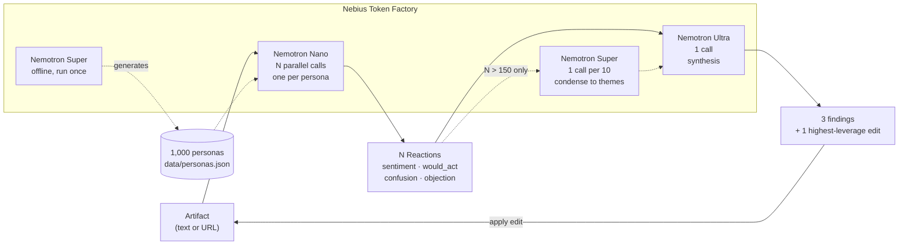

# Panel

**Find out who you're losing, and why — before you ship.**

Paste a landing page, ad, pricing page, or policy notice. A panel of
distinct synthetic people — 100 by default, up to 1,000 — reads it in
parallel and reacts the way they actually would in the first twenty seconds:
bored, confused, suspicious, indifferent. One stronger model reads their
reactions (or, above 150 people, themes condensed from them) and tells you the three things that are costing you, which segment
each one affects, and one specific edit to try. Apply the edit and it reruns
the same people so you can see who changed their mind.

A real 100-person copy test costs thousands of dollars and takes a week.
This costs about ten cents and takes a minute or two, depending on load on
Token Factory, or about 15 seconds with fast mode on (see
[Performance](#performance)).

**More than nine in ten personas say "I wouldn't act on this." That's the point.** The
panel is deliberately built to be hard to please (see
[Anti-sycophancy](#anti-sycophancy-why-the-panel-says-no)) — a panel that
tells you your copy is great is worth nothing.

Built for the Nebius x NVIDIA Global AI Hackathon, Best Apps and Agents
track.

---

## Model tiering is the product

Panel needs a hundred cheap opinions and one expensive one. That shape is
only affordable because one open model family ships in three sizes behind a
single API.



| Model | Role | Why this size |
| --- | --- | --- |
| **Nemotron Nano** (`NVIDIA-Nemotron-3-Nano-30B-A3B`) | One reaction call per persona per run (100–1,000) | The work is "stay in character, react in one sentence, fill six short fields." Cheap and fast matters far more than depth — and it's the call that happens N× per run. Fast mode switches its reasoning off ([below](#reasoning-on-or-off)). |
| **Nemotron Super** (`nemotron-3-super-120b-a12b`) | Writes the 1,000-persona pool, once, offline. Above N=150, condenses the reactions into themes, 10 at a time | Persona quality is a one-time cost every future run inherits, so it's worth a mid-size model. The condensing job we twice assigned wrongly before measuring properly — it left for Nano and came back (see [what we learned](#what-we-learned-building-this)); paired over 10 trials at the shipped batch size, Super wins on reliability, latency and richness alike. |
| **Nemotron Ultra** (`Nemotron-3-Ultra-550b-a55b`) | 1 synthesis call per run | Reads the reactions (or, at large N, the themes condensed from them) plus a persona table and has to find the non-obvious pattern, name the affected segment, and quote the artifact verbatim. This is the one call where model size is worth paying for. Its reasoning pass is off: on Token Factory it arrived inside the answer, and was mostly Ultra counting personas by hand, which Python redoes anyway ([below](#reasoning-on-or-off)). |

At N ≤ 150 Ultra reads the raw reactions directly; above it, Super makes
one extra pass to condense them first, because 1,000 raw reactions is a
400k-token prompt. That split is the whole reason a 1,000-person panel
costs well under a dollar.

### Nebius services used

- **Token Factory** — all inference. Every Nano, Super, and Ultra call goes
  through `api.tokenfactory.nebius.com` via the OpenAI-compatible API. This
  is the project's qualifying runtime dependency and is not optional or
  incidental: there is no local model and no other provider.
- **Hosting:** Google Cloud Run rather than Nebius AI Cloud. Stated plainly
  because the submission checklist asks: we have Token Factory credits but
  not AI Cloud credits, and Serverless Endpoint hosting for a CPU-only web
  app would have been real out-of-pocket cost for an app that mostly sits
  idle between judging sessions. Inference is 100% Nebius either way.

### Where Token Factory accelerated our workflow

- **Three tiers, one API, so tiering is a one-line decision.** Nano, Super
  and Ultra sit behind the same OpenAI-compatible endpoint with the same
  `json_schema` response format, so every call in the codebase goes through
  one function (`panel/tf_client.py`'s `chat_json`). Moving the condensing
  job between tiers — which we did twice, on measurement — meant changing
  one constant (`MODEL_DIGEST`), not an integration.
- **Fan-out without a queue.** 50 concurrent Nano calls ran with zero
  429s at every level we tested, so 100 personas read the copy in 35
  seconds from a plain `asyncio` semaphore. No job queue, no worker pool.
- **Structured output on every tier.** All three models return
  schema-conforming JSON directly, which is what lets Python, not the
  model, do every count in the report.
- **The persona pool was built on the same API.** Super generated and
  repaired all 1,000 personas offline (`scripts/gen_personas.py`), and the
  anti-sycophancy gate runs the real Nano reaction call against them.
- **Cheap enough to measure properly.** Every architectural decision in
  [what we learned](#what-we-learned-building-this) came from repeated
  paired trials against the live models (`scripts/probe_nemotron.py`).
  At these prices, ten trials per configuration is affordable, and it
  reversed two of our conclusions.
- **Visible per run.** After every run the UI shows how many Nano, Super
  and Ultra calls it actually made, retries included.

### Compare against the market (Tavily)

After a run, one button puts the same people in front of two or three
competitors' pages for the same kind of product, and reports which
confusions and objections readers raised on every page (a problem with the
category) versus only on yours (a problem you can fix). It calls Tavily at
runtime, twice over (`panel/market.py`):

1. Nano turns your copy into a search, and **Tavily Search** finds
   candidate pages, with review sites and aggregators excluded up front.
2. Most results are still listicles (9 of 12 for the meal-planning search
   on 2026-10-29), so candidates pass a local filter on host, path and
   title, then one Nano call that picks companies' own product pages and
   may pick none. That day it found three real product pages for each of
   the three examples.
3. **Tavily Extract** pulls each page's text, and the same personas (up to
   50) read each one. Super condenses each page's reactions into themes,
   one Nano call aligns differently worded themes across pages, and Python
   counts which page raised what.

There is deliberately no head-to-head conversion score: a reader who would
buy from a competitor may be reacting to their price or brand, not their
writing. The panel lists every URL it used and the exact text it read from
each. Without `TAVILY_API_KEY` the button is hidden and URL input uses the
direct fetch.

---

## Setup

```bash
# 1. clone, then set your key
cp .env.example .env
#    put your Token Factory key in TF_API_KEY

# 2. backend deps
pip install -r requirements.txt
#    (if `python3 -m venv .venv` fails with an ensurepip error:
#     apt install python3.14-venv, or use
#     pip install --user --break-system-packages)

# 3. build the frontend
cd web && npm install && npm run build && cd ..

# 4. run it — serves the API and the built UI on one port
uvicorn api.main:app --port 8000
#    open http://localhost:8000
```

For frontend development with hot reload, run `npm run dev` in `web/` in a
second terminal (it proxies API calls to port 8000). Add `?mock=1` to the URL
to drive the whole UI from synthetic data with zero API calls and zero cost —
useful for working on the interface without spending credits.

Try it from the command line instead:

```bash
python run.py --artifact data/examples/pricing_v1.txt --n 100
```

Run the tests with `make test` — the whole suite is offline, so it costs
nothing and makes no model calls.

A note on the deployed configuration: Cloud Run serves the app to
`allUsers`, because judges need a link rather than credentials, and every
run spends real credits. So:

- `MAX_PERSONA_COUNT`, `MAX_CONCURRENT_RUNS` and per-client rate limits on
  every endpoint that calls a model (`RATE_LIMIT_RUNS`,
  `RATE_LIMIT_CHECKS`, `RATE_LIMIT_COMPARES`) bound what one caller can
  spend — generous for a person, useless for a script. Clients are keyed by
  the address Cloud Run appends to `X-Forwarded-For`
  (`TRUSTED_PROXY_HOPS=1`), never by a client-supplied one.
- Daily budgets on top of that: 10,000 persona reactions per rolling 24
  hours across the whole service (`DAILY_PERSONA_BUDGET`) and 2,000 per
  client (`DAILY_CLIENT_PERSONA_BUDGET`), plus service-wide daily caps on
  compares and checks. A run is charged for the calls it actually sent, so
  cancelling one gives the rest back. Cached replays are free and exempt.
- A compare result is computed once per pair of runs and reused.
- Run ids are 128-bit random tokens, since an id is the only key to a run's
  pasted text.
- No CORS: the app serves its own frontend, so other sites can't drive it
  from their visitors' browsers.
- URL input is fetched with SSRF checks on every redirect hop, and pasted
  text is framed to every model as material to react to, never
  instructions to follow.

See `.env.example` and `infra/variables.tf`; locally the limits default
to permissive values.

---

## Anti-sycophancy: why the panel says no

An LLM asked to role-play a customer will flatter you by default. That makes
a synthetic panel worthless. Three things push against it:

1. **The personas are built skeptical.** Generation requires at least 3 of
   every 10 personas to have skepticism ≥ 70/100 — the shipped pool lands
   at 386 of 1,000 — and the pool spans most of the 1-100 scale on all
   seven numeric traits (tech comfort, skepticism, and the Big Five): tech
   comfort runs 4-96, skepticism 8-90, and the narrowest, neuroticism, 5-85.

   The pool is also exactly stratified and globally unique, which the
   generator checks and fails on: **125 personas per region** across 8
   regions, **200 per age band** across 5, **200 per income band** across
   5, **zero duplicate names** in 1,000, and no occupation held by more
   than **0.9%** of the pool. Verify with
   `python -c "from panel.personas import *; print(len(find_duplicate_names(load_personas())))"`.
2. **The reaction prompt forbids helpfulness.** It asks for the real first-20-seconds
   reaction, tells the model indifference is an acceptable answer, and
   defaults `would_act` to false unless something specifically moved them.
3. **It's verified, not assumed.** `scripts/gen_personas.py` reacts the
   personas to all three example artifacts and fails the build unless mean
   sentiment lands within [-0.8, +0.8] and at least 25% of them say
   `would_act: false` on every artifact. Measured on the shipped
   1,000-persona pool (a fixed 150-persona sample — 3,000 Nano calls to
   pin down a number a few hundred already settles to within a point):

   | Artifact | Mean sentiment | `would_act: false` |
   | --- | --- | --- |
   | `pricing_v1.txt` | -0.28 | 146/150 (97%) |
   | `ad_v1.txt` | -0.48 | 147/150 (98%) |
   | `policy_v1.txt` | -0.30 | 150/150 (100%) |

   Passed on the first attempt, with no forced-skepticism rewrites.

---

## Performance

Measured on 2026-10-27 against `data/examples/pricing_v1.txt`, 100 real Nano
calls per row:

| Concurrency | Elapsed | p50 latency | p95 latency | 429s |
| --- | --- | --- | --- | --- |
| 10 | 94.9s | 8.6s | 11.8s | 0 |
| 25 | 60.2s | 12.9s | 21.5s | 0 |
| 50 | 35.3s | 14.6s | 20.4s | 0 |

Zero 429s at every level tested, so `MAX_CONCURRENCY=50` — **100 reactions in
35.3 seconds.** That is the best case, not the typical one: per-call latency
moves with load on the shared endpoint. Re-recording the three examples on
2026-10-28, median Nano latency was 20-33s per call rather than 14.6s, so the
panel took roughly 70-140s to read. On 2026-10-29 a full 100-person run,
reading plus report, took 57s on the pricing example and 80s on the ad.

### Reasoning on or off

All three Nemotron models reason before they answer. Token Factory honours
exactly one control over that, `chat_template_kwargs: {"enable_thinking":
false}`; `/no_think`, `reasoning_effort` and every reasoning-budget
parameter we tried are silently ignored. So reasoning is all or nothing,
and Panel uses it in two places:

**Ultra's report: always off.** With reasoning on, Ultra's reasoning came
back inside the answer, and most of it was Ultra counting personas by hand
(the arithmetic `_apply_recounted_pct` does anyway). Every recording ran
past 6,000 and then 12,000 tokens before fitting in 24,000, about a minute
and a half per report. Off, 9 of 9 reports on the three examples were valid
first try, at 660-860 tokens and 4-5 seconds, with comparable headlines,
segments and edits. The report step went from about 90s to 3-4s.

**Super's condensing: always off.** Its reasoning stayed hidden, but cost
the same way: 12 shards of 10 reactions, on versus off, were all valid
both ways, at a 38s versus 6s median and ~5,400 versus ~530 completion
tokens, with as many themes and quotes per shard. This step runs above
150 personas and once per page in every market comparison.

**Ultra's compare summary: left on.** One sentence after Apply and
compare, already about 2s with reasoning on, and the sentences read the
same either way.

**Nano's reactions: the user's choice.** A "Fast mode" switch next to the
Run button turns Nano's reasoning off. Measured on the default 100 people,
all three examples:

| | Reasoning on (default) | Fast mode |
| --- | --- | --- |
| Median reaction call | 13-21s | 3-7s |
| Full run, reading plus report (pricing / ad) | 57s / 80s | 14s / 14s |
| Valid on the first try | 92-98 of 100 | 100 of 100 |
| Reacting negatively (pricing / ad / policy) | 35% / 53% / 29% | 13% / 35% / 16% |
| Would act (pricing / ad / policy) | 4 / 8 / 0 | 3 / 16 / 0 |

The cost is clear opinions: answering on instinct, far more personas land
on the fence, so every "N% reacted negatively" comes out lower. It needed
two changes to get even that close (`ReactionAnswer` in
`panel/schemas.py`). The objection fields became required strings, because
with reasoning off Nano left them null on 9-14 calls in 20. And the verdict
moved to the end of the schema: written first, 12 of 40 personas said they
would act on the pricing page, against 3 of 40 written last and 1 of 38
with reasoning on. Fast mode stays off by default, and its info button says
plainly that a fast run's numbers aren't comparable with a normal one.

Above N=150 a condensing pass is added. Measured end to end at N=200:

| Condensing design | Shards lost | Condense + synthesis | Total |
| --- | --- | --- | --- |
| Super, 50 per shard | 2 of 4 | 644s | 721s |
| Nano, 50 per shard | 2 of 4 | 239s | 321s |
| Nano, 10 per shard | 0 of 20 | 97s | 181s |
| **Super, 10 per shard** (shipped) | **0 of 20** | **48s** | **130s** |

Switching Super's reasoning off (below) then took condense + synthesis at
N=200 from 48s to 9.4s on 2026-10-29, with all 20 shards succeeding.

Five and a half times faster than where it started, and only the
small-batch rows read the whole panel rather than half of it. All of that
came from the batch size, not the model — note that the same model which
was worst at 50 per shard is best at 10
(see [what we learned](#what-we-learned-building-this) — getting this
wrong twice is the most instructive thing in the project).

Extrapolating to a full 1,000-persona panel: ~6 minutes of reading, well
under a minute of condensing (100 calls in two waves of 50, about 6s each
with reasoning off), plus a few seconds of synthesis — roughly 7 minutes,
against an 1,800s request timeout. The default stays at
100 because a minute or two is a different kind of experience.

---

## What we learned building this

The non-obvious findings, because they shaped the architecture. The
model-behaviour ones are written up properly, with full measurement
tables, in [FEEDBACK.md](FEEDBACK.md) — and the two that drove design
decisions are reproducible with `python scripts/probe_nemotron.py`.

- **All three Nemotron models spend completion-token budget on hidden
  reasoning before emitting content, and how much is stochastic.** The spec
  we wrote assumed `max_tokens=400` was plenty for a six-field JSON
  reaction. In practice essentially every call truncated before reaching
  content. The same prompt at the same budget succeeded on one call and
  truncated with zero content on an immediate retry. Fix: a measured
  budget (`REACTION_MAX_TOKENS=3000`, observed usage peaking at 2092) plus
  treating `finish_reason == "length"` as a distinct retry case from
  "content didn't validate," since they need opposite responses.
- **A token budget that *usually* fits is the expensive kind of wrong.**
  Persona generation ran at `max_tokens=8000` against a prompt needing ~4.5k
  of content and ~3.4k of reasoning. It worked — every truncated call was
  silently retried at double the budget — so the only symptom was speed: a
  900-persona run paced at 110 minutes instead of 25. Sitting *near* the
  ceiling costs about 2.3× the tokens and wall-clock of sitting well above
  it, and the retry that hides the problem is what makes it invisible.
- **Don't ask an LLM to count.** Ultra's `affected_pct` claims were off by
  12-70 percentage points on the pricing example and by as much as 82
  across the three, and a retry with the exact discrepancy spelled
  out produced identical wrong numbers. So Ultra proposes *which* segment
  matters as a structured filter, and Python computes the percentage from
  the actual reactions: how many people match the filter, and what share of
  them reacted negatively. Every finding's number is counted, not
  estimated, and the prompt bars the headline and claims from citing any
  other figure; a filter that can't be recounted is shown labelled as an
  estimate. (Counting the right thing took a second pass: our first
  recount measured the segment's share of the *panel*, a true number
  answering a different question than the sentence printed above it.)
  Severity is counted the same way: a finding is high when its segment is
  20+ points more negative than the whole panel, medium at 10-19, low
  below that, and each row shows the whole-panel rate next to its own.
  The rows sort by it, and the headline is always about the top row: when
  Ultra's own headline doesn't quote that row's counted number, the row's
  claim replaces it.
- **…and asking anyway isn't merely unreliable, it's destructive.** We
  learned the same lesson a second time writing the shard digests, and it
  took two tries to stop asking. v1 wanted a theme, the persona IDs
  expressing it, *and* a count, ordered most-common-first: on a real
  200-person run one shard spent 32,000 completion tokens — every rung of
  the retry ladder — reasoning about those counts and emitted **zero**
  content, discarding half the panel's data. v2 dropped the count but still
  asked for *every* ID under each theme: no truncation, but the stage ran
  for over eight minutes, because exhaustively classifying 50 reactions into
  three categories is the same long serial task wearing a different hat.
  v3 asks for themes plus **2-5 examples**, capped in the schema, and prints
  no quantity at all. Every finding's number comes from recounting
  Ultra's segment filter against the real personas — which is where this
  project's numbers came from in the first place.
- **Benchmark at the configuration you ship.** "Condense a batch of
  reactions" reads like mid-tier work, so Super got it. Raced head-to-head
  against Nano on one real 50-reaction shard, Nano finished in 83s with 10
  themes and the 5 required quotes; Super took 157s, returned 13 themes and
  **zero** quotes, and on live runs exhausted the whole truncation ladder on
  some shards. We moved the job to Nano. Then the batch size dropped to 10
  for unrelated reasons, and a paired 10-trial comparison at *that* size
  reversed the result: Super 10/10 at 38s median with richer themes, Nano
  9/10 at 54s. The single trial had measured a batch-size problem and
  blamed the model. The job went back to Super, and that is what ships.
- **A graceful degradation path is worth building before you need it.**
  That failed shard didn't fail the run — `_digest_shard` returns `None`,
  the label tells Ultra it's seeing 100 of 200 reactions, and the report
  that came out was still coherent and correctly segmented. Every Nano call
  was already paid for by the time digesting starts, so "lose a shard" has
  to beat "lose the run."
- **Personas ask for things text can't deliver.** Early reaction data was
  full of "show me a video," "add a screenshot," "link a live dashboard" —
  unanswerable by any copy edit, so they poisoned the edit suggestions. The
  reaction prompt now requires a change to the words on the page.
- **Synthetic people are hard to persuade, and that's honest.** One good
  edit flips roughly 0-7 of 100, not the 20+ we hoped. We tested
  single-phrase edits, multi-theme rewrites, and edits targeting the single
  most-requested change; the ceiling held. We report the real number.

---

## Honest limitations

- **Directional, not a replacement for real research.** These are language
  models role-playing demographics, not humans. Use it to catch the
  confusions and objections you can't see in your own copy, not to forecast
  conversion rates.
- **Flip counts sit close to the noise floor.** An unchanged rerun moved
  4-7 people in 100 at temperature 0.7 (the shipped 0.4 should be quieter;
  `scripts/measure_noise.py` measures it), so a small flip count is not
  evidence on its own. The compare view says so next to every count.
- **One edit moves few people.** See above — expect a few percent. The
  diagnosis is the value; the flip count is a sanity check on it.
- **Run state is in memory.** A server restart loses in-flight runs, and the
  deployment must be pinned to a single instance or SSE reconnects will land
  on an instance that doesn't know the run.
- **Compare requires identical persona counts** on both runs, enforced in
  the UI by locking the control once a compare starts.
- **The market comparison is only as good as its page picks.** Search
  results for a category are mostly listicles and reviews; the filters
  described above catch most of them, not all, which is why the panel
  shows every URL it used and the exact text it read from each.
- **A 1,000-person run takes about eight minutes**, because throughput is
  concurrency-bound (50 concurrent Nano calls) and the panel size is the
  numerator. The default stays at 100 for that reason; the slider goes to
  1,000 when the question is worth the wait.
- **Occupations repeat in the pool, names don't.** All 1,000 full names are
  unique and that's enforced; occupations are a measured target rather than
  a gate, because 1,000 people genuinely do include more than one nurse.
  732 of 1,000 are distinct, and the most common one is 9 people (0.9% of
  the pool) — against 5 of 100 (5.0%) before the scale-up.
- **The pool over-represents unusual jobs.** Telling the generator to avoid
  stock occupations worked, and then kept working: six lighthouse keepers
  and nine funeral directors per thousand people is not what a real
  population looks like. It makes the crowd feel varied, which is what the
  grid needs, but don't read the occupation mix as demographically faithful.
- **Some traits cluster despite the prompt.** Tech comfort spreads across 63
  distinct values in 1,000 personas; extraversion only 30, most of them
  between 38 and 55. The model rounds to familiar numbers no matter how
  firmly it's asked not to, so the Big Five traits carry less signal at the
  edges than skepticism and tech comfort do.

---

## License

MIT, see [LICENSE](LICENSE).
