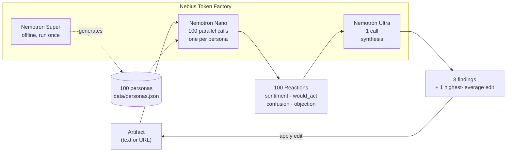

# Panel

**Find out who you're losing, and why — before you ship.**

Paste a landing page, ad, pricing page, or policy notice. 100 distinct
synthetic people read it in parallel and react the way they actually would in
the first twenty seconds: bored, confused, suspicious, indifferent. One
stronger model reads all 100 reactions and tells you the three things that
are costing you, which segment each one affects, and one specific edit to
try. Apply the edit and it reruns the same 100 people so you can see who
changed their mind.

A real 100-person copy test costs thousands of dollars and takes a week.
This costs cents and takes about forty seconds.

**99 of 100 personas say "I wouldn't buy this." That's the point.** The
panel is deliberately built to be hard to please (see
[Anti-sycophancy](#anti-sycophancy-why-the-panel-says-no)) — a panel that
tells you your copy is great is worth nothing.

Built for the Nebius x NVIDIA Global AI Hackathon, Best Apps and Agents
track.

---

## Model tiering is the product

Panel needs a hundred cheap opinions and one expensive one. That shape is
only affordable because one open model family ships in three sizes behind a
single API.



| Model | Role | Why this size |
| --- | --- | --- |
| **Nemotron Nano** (`NVIDIA-Nemotron-3-Nano-30B-A3B`) | 100 reaction calls per run | The work is "stay in character, react in one sentence, fill six short fields." Cheap and fast matters far more than depth — and it's the call that happens 100× per run. |
| **Nemotron Super** (`nemotron-3-super-120b-a12b`) | Generates the 100 personas, once, offline | Persona quality is a one-time cost that every future run inherits, so it's worth a mid-size model. Needs enough capability to write people who feel specific rather than demographic averages. |
| **Nemotron Ultra** (`Nemotron-3-Ultra-550b-a55b`) | 1 synthesis call per run | Reads all 100 reactions plus a persona table and has to find the non-obvious pattern, name the affected segment, and quote the artifact verbatim. This is the one call where reasoning depth is worth paying for. |

### Nebius services used

- **Token Factory** — all inference. Every Nano, Super, and Ultra call goes
  through `api.tokenfactory.nebius.com` via the OpenAI-compatible API. This
  is the project's qualifying runtime dependency and is not optional or
  incidental: there is no local model and no other provider.
- **Hosting:** Google Cloud Run rather than Nebius AI Cloud. Stated plainly
  because the submission checklist asks: we have Token Factory credits but
  not AI Cloud credits, and Serverless Endpoint hosting for a CPU-only web
  app would have been real out-of-pocket cost for an app that mostly sits
  idle between judging sessions. Inference is 100% Nebius either way.

---

## Setup

```bash
# 1. clone, then set your key
cp .env.example .env
#    put your Token Factory key in TF_API_KEY

# 2. backend deps
pip install -r requirements.txt
#    (if `python3 -m venv .venv` fails with an ensurepip error:
#     apt install python3.14-venv, or use
#     pip install --user --break-system-packages)

# 3. build the frontend
cd web && npm install && npm run build && cd ..

# 4. run it — serves the API and the built UI on one port
uvicorn api.main:app --port 8000
#    open http://localhost:8000
```

For frontend development with hot reload, run `npm run dev` in `web/` in a
second terminal (it proxies API calls to port 8000). Add `?mock=1` to the URL
to drive the whole UI from synthetic data with zero API calls and zero cost —
useful for working on the interface without spending credits.

Try it from the command line instead:

```bash
python run.py --artifact data/examples/pricing_v1.txt --n 100
```

---

## Anti-sycophancy: why the panel says no

An LLM asked to role-play a customer will flatter you by default. That makes
a synthetic panel worthless. Three things push against it:

1. **The personas are built skeptical.** Generation requires at least 3 of
   every 10 personas to have skepticism ≥ 70/100, and the pool spans the
   full 1-100 range on seven numeric traits (tech comfort, skepticism, and
   the Big Five).
2. **The reaction prompt forbids helpfulness.** It asks for the real first-20-seconds
   reaction, tells the model indifference is an acceptable answer, and
   defaults `would_act` to false unless something specifically moved them.
3. **It's verified, not assumed.** `scripts/gen_personas.py` runs all 100
   personas against all three example artifacts and fails the build unless
   mean sentiment lands within [-0.8, +0.8] and at least 25 personas say
   `would_act: false` on every artifact. Measured on the shipped pool:

   | Artifact | Mean sentiment | `would_act: false` |
   | --- | --- | --- |
   | `pricing_v1.txt` | -0.23 | 95/100 |
   | `ad_v1.txt` | -0.30 | 92/100 |
   | `policy_v1.txt` | -0.24 | 100/100 |

---

## Performance

Measured against `data/examples/pricing_v1.txt`, 100 real Nano calls per row:

| Concurrency | Elapsed | p50 latency | p95 latency | 429s |
| --- | --- | --- | --- | --- |
| 10 | 94.9s | 8.6s | 11.8s | 0 |
| 25 | 60.2s | 12.9s | 21.5s | 0 |
| 50 | 35.3s | 14.6s | 20.4s | 0 |

Zero 429s at every level tested, so `MAX_CONCURRENCY=50` — **100 reactions in
35.3 seconds.** A full run including synthesis lands around 40-90s depending
on how long Ultra reasons.

---

## What we learned building this

The non-obvious findings, because they shaped the architecture:

- **All three Nemotron models spend completion-token budget on hidden
  reasoning before emitting content, and how much is stochastic.** The spec
  we wrote assumed `max_tokens=400` was plenty for a six-field JSON
  reaction. In practice essentially every call truncated before reaching
  content. The same prompt at the same budget succeeded on one call and
  truncated with zero content on an immediate retry. Fix: a measured
  budget (`REACTION_MAX_TOKENS=3000`, observed usage peaking at 2092) plus
  treating `finish_reason == "length"` as a distinct retry case from
  "content didn't validate," since they need opposite responses.
- **Don't ask an LLM to count.** Ultra's `affected_pct` claims were off by
  12-82 percentage points, and a retry with the exact discrepancy spelled
  out produced identical wrong numbers. So Ultra proposes *which* segment
  matters as a structured filter, and Python computes the percentage from
  the actual reactions. Every number in the findings panel is counted, not
  estimated.
- **Personas ask for things text can't deliver.** Early reaction data was
  full of "show me a video," "add a screenshot," "link a live dashboard" —
  unanswerable by any copy edit, so they poisoned the edit suggestions. The
  reaction prompt now requires a change to the words on the page.
- **Synthetic people are hard to persuade, and that's honest.** One good
  edit flips roughly 0-7 of 100, not the 20+ we hoped. We tested
  single-phrase edits, multi-theme rewrites, and edits targeting the single
  most-requested change; the ceiling held. We report the real number.

---

## Honest limitations

- **Directional, not a replacement for real research.** These are language
  models role-playing demographics, not humans. Use it to catch the
  confusions and objections you can't see in your own copy, not to forecast
  conversion rates.
- **One edit moves few people.** See above — expect single digits out of
  100. The diagnosis is the value; the flip count is a sanity check on it.
- **Run state is in memory.** A server restart loses in-flight runs, and the
  deployment must be pinned to a single instance or SSE reconnects will land
  on an instance that doesn't know the run.
- **Compare requires identical persona counts** on both runs, enforced in
  the UI by locking the control once a compare starts.
- **The Tavily URL-extraction path is unverified.** We had no key; the
  `requests` + `readability-lxml` fallback is what's tested.
- **Scaling to 1,000 personas** is a config change plus a bigger
  `personas.json`, and the synthesis step would need sharding (Ultra reading
  summaries rather than 1,000 raw reactions). Not done.

---

## License

MIT, see [LICENSE](LICENSE).
